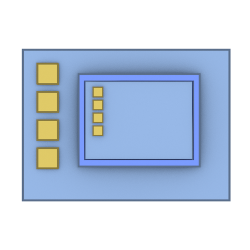
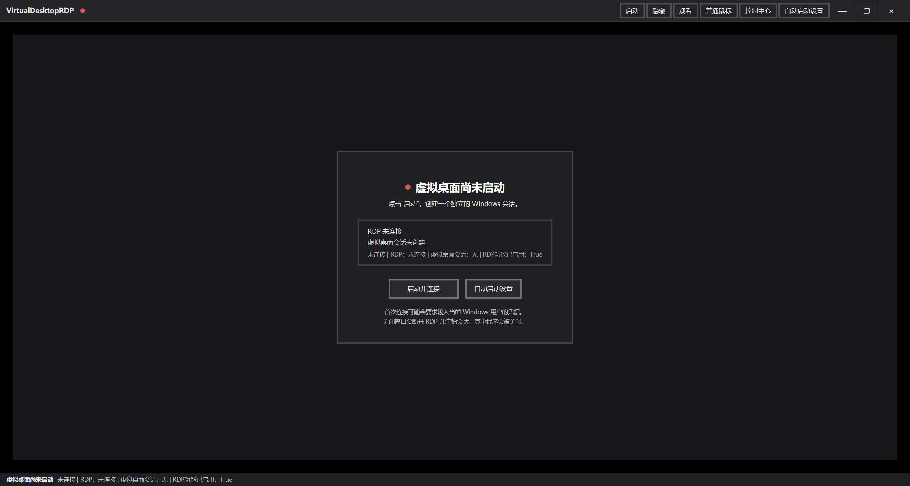
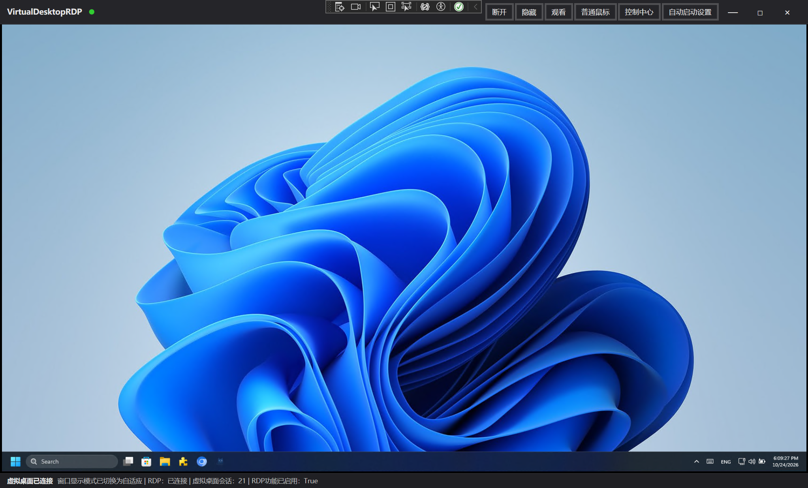
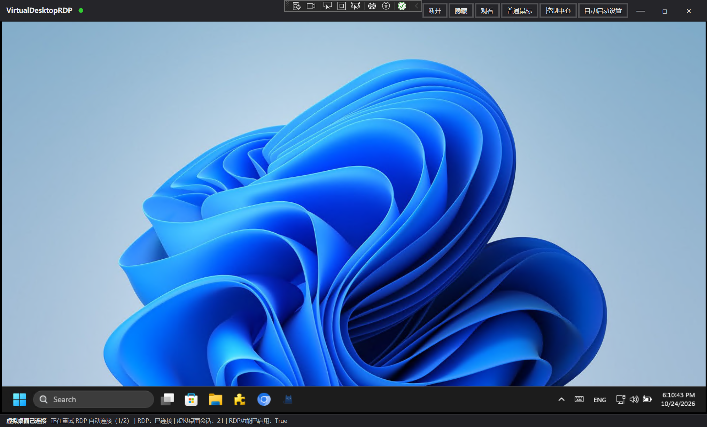
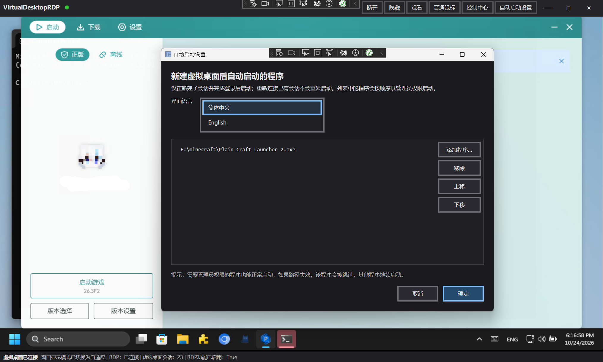
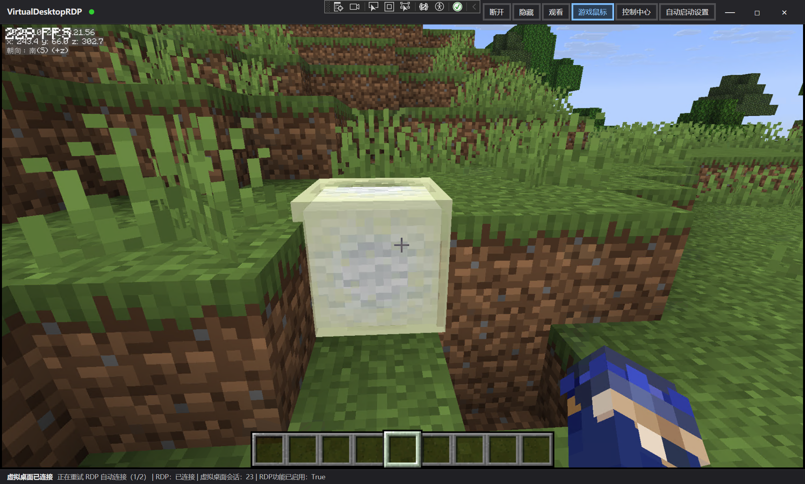

# VirtualDesktopRDP

<!-- 从 BetterGI 的“桌面分身”功能中提取的程序。它不做远程桌面协议实现，而是组合 Windows 自带能力： -->

提取自[BetterGI](https://github.com/babalae/better-genshin-impact) 的“桌面分身”功能。利用Windows 远程桌面连接(RDP)实现。


## 环境要求

- Windows 10 / 11 非家庭版（家庭版可能可用，但不受微软支持）
> 部分 家庭版Windows / 精简版Windows 可能会出现RDP组件缺失，可以尝试https://github.com/stascorp/rdpwrap/
> 但是这是最后的办法，在这之前建议尝试`DISM.exe /Online /Cleanup-image /Restorehealth`+`sfc /scannow`修复系统损坏和缺失文件。

- 以管理员权限运行
- 系统 RDP 未被关闭、未被 RDP Wrapper 接管
- 不要在桌面分身运行期间直接关机/重启；先关闭本程序并注销会话


<details>

<summary>它不做远程桌面协议实现，而是组合 Windows 自带能力：</summary>

- `WTSEnableChildSessions` / `WTSGetChildSessionId` / `WTSLogoffSession`
- 本机 RDP ActiveX `MsRdpClient10` 的 `ConnectToChildSession`
- 任务计划程序 `RunEx(..., TASK_RUN_USE_SESSION_ID, ...)` 投递进程
- RDP 输入窗口 `Input Capture Window` 的 `EnableWindow` 控制（观看模式）


</details>

## 功能

- 启动 / 连接本机
- 隐藏到托盘（RDP 连接保持）
- 关闭并注销
- 观看模式（屏蔽本机键鼠进入子会话）
- 游戏鼠标（RDP 相对鼠标，适合在虚拟桌面中操作游戏；依赖 Windows 11 24H2 及以上的 RDP 相对鼠标支持） *按住 **`Alt`** 临时释放并显示本机鼠标，松开后自动重新锁定*
- 自适应 / 1:1、保持 16:9
- 输入自定义 RDP 分辨率（800×600 起，超过 2560×1440 会提示）
- 小窗模式
- 系统组合键发送到虚拟桌面
- 音频静音
- 发送 Win+D
- 以管理员权限在子会话中启动任意 `.exe`
- 新建会话后按列表自动启动程序

<details>
<summary>截图</summary>

#### 界面




#### 连接


#### 1280×720分辨率
很遗憾，如果在运行远程桌面时调整分辨率和显示方式，需要重新调整窗口大小才能正常使用。目前**尚无**能力解决该问题。



#### 自动启动应用程序


#### 游戏鼠标
>游戏鼠标模式下，回报率最大为100Hz。


## 防火墙

本项目启动时会自动检查并写入一条针对当前 `VirtualDesktopRDP.exe` 的入站放行规则（所有网络配置文件）。如果失败，可以在“控制中心 → 更多 → 修复防火墙规则”中重试。

## 分辨率

控制中心“显示”中的“分辨率 W×H”可以输入自定义 RDP 分辨率。

- 最低 800×600，低于该值会直接拒绝；
- 超过 2560×1440 会弹出确认提示，确认后仍可应用；
- 最大 8192×8192；
- 已连接时修改会自动重连 RDP，但不会注销会话；
- 未连接时只保存设置，下次连接生效。

## 自动启动列表

工具栏“设置”或托盘菜单“自动启动设置”可以维护 `.exe` 列表。新建 Child Session 并完成 RDP 登录后，列表中的程序会按顺序以管理员权限启动；重新连接已有会话不会重复启动。单个程序失败会被跳过，其余程序继续启动。

配置保存在：

```text
%LOCALAPPDATA%\VirtualDesktopRDP\settings.json
```

```bash
notepad %LOCALAPPDATA%\VirtualDesktopRDP\settings.json
edit %LOCALAPPDATA%\VirtualDesktopRDP\settings.json
```


## 多语言

界面支持简体中文和 English，可在“自动启动设置”窗口中切换，选择会保存到 `settings.json` 的 `Language` 字段。

- 简体中文原文同时作为翻译键，默认直接显示；
- 其他语言放在 `I18n/<language>.json`，格式为“中文原文 -> 译文”；
- 启动时会扫描 `I18n` 目录下所有 `*.json` 并生成语言列表，新增语言只需添加对应 JSON 文件，无需修改代码；
- 语言显示名使用该语言自身的 `CultureInfo.NativeName`。

## 构建

```powershell
dotnet build .\VirtualDesktopRDP.csproj
```

生成的程序位于 `bin\Debug\net10.0-windows8.0\VirtualDesktopRDP.exe`。直接双击会请求管理员权限。

## GitHub Actions

仓库包含两个 Windows 发布工作流，均使用 `Properties/PublishProfiles` 中的“依赖框架 + 单文件”配置：

- `Build x64`：每次 `push` 自动使用 `Lite64.pubxml` 发布 `win-x64`，生成 `VirtualDesktopRDP-win-x64` artifact；
- `Publish all architectures`：在 GitHub Actions 页面点击 `Run workflow`，并行发布 `win-x86`、`win-x64`、`win-arm64`，分别生成三个 artifact。

发布产物是依赖框架的单文件程序，目标机器需要安装 **.NET 10 Desktop Runtime**。`I18n` 目录会随 artifact 一起上传，保持多语言可用。

## 代码结构

```text
Services/
  ChildSessionNativeMethods.cs      WTS / 注册表 / RDP 输入窗口
  ChildSessionEnvironmentCheck.cs   启动前环境检查
  ChildSessionService.cs            连接、重试、设置、自动启动、注销
  ChildSessionProcessLauncher.cs    计划任务投递
  FirewallService.cs                应用级防火墙入站规则
Rdp/
  RdpActiveXHost.cs                 MsRdpClient10 AxHost 封装
ViewModels/
  MainWindowViewModel.cs            主窗口状态与命令
I18n/
  I18nService.cs                    语言切换与翻译查找
  TExtension.cs                     XAML 翻译标记
  en-US.json                        英文翻译
Dialogs/
  AppMessageBox.cs                  统一消息框入口
  AppMessageBoxWindow.xaml          直角 3px 边框消息框
  ResolutionWindow.xaml             分辨率输入与校验
Infrastructure/
  SettingsService.cs / AppSettings.cs
  ObservableObject.cs / RelayCommand.cs
MainWindow.xaml / MainWindow.xaml.cs
SettingsWindow.xaml / SettingsWindow.xaml.cs
```

## 说明

RDP 的登录凭据由 Windows 的 RDP ActiveX 登录流程处理，本程序不保存用户名或密码。首次连接时可能会要求输入当前 Windows 用户的凭据；PIN、Windows Hello、微软账户密码不同步等都可能导致登录失败。

## 来源与许可

本项目从 [BetterGI（better-genshin-impact）](https://github.com/babalae/better-genshin-impact) 的“桌面分身”实现中提取并改写，主要沿用其 Child Session 原生调用、RDP ActiveX 封装、环境检查、进程投递和会话生命周期逻辑。

本项目在  下开源


[协议](LICENSE.txt)